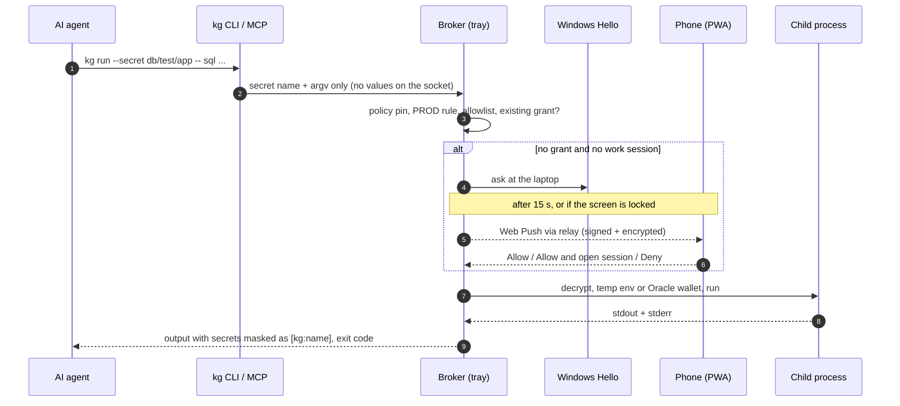

<div align="center">


# KeyGate

**A secret broker for AI coding agents.**<br>
Agents use passwords, API tokens and Oracle wallets without ever seeing them.

**English** · [Tiếng Việt](README.vi.md)

[](LICENSE)




[Why](#why) · [How it works](#how-it-works) · [Before and after](#before-and-after) · [Quick start](#quick-start) · [Security model](#security-model) · [Docs](#documentation)

</div>

---

## Why

> **228** passwords and tokens sat in 9 plain-text `.env` files on one developer laptop before they moved into KeyGate.

If an AI agent can read a file, it can read every password in it. Nobody means harm, but one slip is enough:

| Risk | What happens |
|---|---|
| **Leaks into answers** | The agent pastes a password into a chat, a report or a message it sends. |
| **Stays in logs** | A secret printed on screen ends up in a log file that travels everywhere. |
| **No trail** | Nobody knows which secret the agent used, against which system, at what time. |

## How it works

Think of a hotel front desk. The agent never holds the key. It asks the desk, the desk checks the book, you nod, and the desk opens the door for it.

| | Step | What happens |
|:-:|---|---|
| **1** | **The agent asks** | `kg run --secret db/test/app -- sql /@ebs_test @report.sql`: which secret, for which command. |
| **2** | **KeyGate checks the book** | Is this program, with these arguments, allowed for this secret in your pinned `policy.yaml`? Production secrets are denied by default. |
| **3** | **You approve** | One Windows Hello glance at the laptop, or tap **Allow** on your paired phone when you are away. Approve once and KeyGate remembers the pair. |
| **4** | **KeyGate opens the door** | The broker runs the command itself, injects the secret, and masks it in the output as `[kg:<name>]`. |

**The agent gets the result. The key never leaves the desk.**



### A day with KeyGate

| Time | |
|---|---|
| **07:45** | Log in, glance at the camera once. The vault opens and a work session starts; the tray icon turns green. |
| **09:00** | The agent runs queries, files tickets and syncs data all morning. Approved jobs run without asking again. |
| **14:00** | You end the session and go to a meeting. The agent needs a secret for the first time; your phone buzzes, you tap Allow or Deny. |
| **17:30** | Open the audit log: which secret, which command, which system, which exit code. Editing or deleting the log is detected. |

## Before and after

| | Before | With KeyGate |
|---|---|---|
| **Where passwords live** | Plain-text config files | An encrypted vault, opened only by your face or fingerprint |
| **Can the agent see them** | Yes, by reading the file | Never |
| **Who decides** | Nobody; readable means usable | You, with one tap |
| **Output printed by mistake** | The password in full | `[kg:name]` instead of the value |
| **Production systems** | Same as any other | Locked by default; opened only per secret, by name |
| **Knowing what the agent did** | No idea | A hash-chained audit log |
| **Lost laptop** | Lost secrets, rotate everything | Restore the vault on a new machine, revoke the old one |

## Features

- **`kg` CLI and broker** in Go (stdlib, `golang.org/x/crypto`, `golang.org/x/sys` only). On Windows the broker lives in the system tray (`kgw tray`).
- **Vault**: XChaCha20-Poly1305 records, one append-only log per device, Ed25519-signed membership events, recovery with master password + paper key.
- **Pinned policy**: per secret, the allowed programs and argument patterns, the approval kind (`user-presence`, `device`, `none` with hash-pinned scripts, `deny`), TTL and max runtime.
- **Secret delivery**: environment variable, temp file, temporary Oracle wallet (SQLcl), or a rendered template. Temp material is overwritten and removed.
- **Output masking**: verbatim, base64 and URL-encoded forms of every injected value.
- **Agent integration**: a PreToolUse hook that blocks reading `.env`, `cwallet*`, dumping the environment, `kg reveal`; an MCP server with `list_secrets`, `request_grant`, `run_with_secret`. No tool returns a value.
- **Phone approvals**: a PWA served by your own Cloudflare Worker, Web Push (tested on iOS), signed and encrypted envelopes, single-use decisions bound to the request hash.
- **Sync**: relay (Cloudflare Workers Free + Durable Object SQLite), git or a shared folder. The relay stores ciphertext and signed lines only.
- **Audit**: hash chain + per-line MAC, anchored head; truncation or deletion is detected.

## Quick start

Ten minutes on a clean Ubuntu 24.04 or Windows 11 machine (x86-64 or arm64): install a release,
check its SHA-256, create a vault, and let one command use a fake secret without seeing it. No Go,
no clone of this repo, no Cloudflare account, no phone.

The CLI speaks Vietnamese. Every prompt you will meet is listed with what to type in
[the prompts you will see](#the-prompts-you-will-see).

### 1. Install on Linux

The install needs `curl`; a minimal Ubuntu install may not have it: `sudo apt install curl`.

With the script (downloads the newest release and `SHA256SUMS`, refuses to install on a checksum
mismatch, installs `kg` to `~/.local/bin`, no `sudo`):

<!-- quickstart:linux-install-script -->
```bash
curl -fsSL https://raw.githubusercontent.com/ds-mrtq/keygate/main/install.sh | sh
export PATH="$HOME/.local/bin:$PATH"
kg version
```

Or by hand. Set `VERSION` to the newest tag on the [Releases page](https://github.com/ds-mrtq/keygate/releases),
and `ARCH` to `arm64` on an ARM machine:

<!-- quickstart:linux-install-manual -->
```bash
VERSION=v0.1.0
ARCH=amd64
curl -fsSLO "https://github.com/ds-mrtq/keygate/releases/download/$VERSION/kg_${VERSION}_linux_$ARCH.tar.gz"
curl -fsSLO "https://github.com/ds-mrtq/keygate/releases/download/$VERSION/SHA256SUMS"
sha256sum -c --ignore-missing SHA256SUMS &&       # must print: kg_..._linux_....tar.gz: OK
  mkdir -p ~/.local/bin &&
  tar -xzf "kg_${VERSION}_linux_$ARCH.tar.gz" -C ~/.local/bin kg
export PATH="$HOME/.local/bin:$PATH"
kg version                                        # must print: kg <VERSION> (commit ..., linux/...)
```

If `sha256sum` does not print `OK`, the download is not the published file and nothing is installed. Add the
`export PATH=...` line to `~/.profile` to keep `kg` on your PATH.

### 2. Install on Windows

In PowerShell, with the script (installs `kg.exe` and `kgw.exe` to
`%LOCALAPPDATA%\Programs\KeyGate` and adds it to your user PATH, no administrator rights):

<!-- quickstart:windows-install-script -->
```powershell
irm https://raw.githubusercontent.com/ds-mrtq/keygate/main/install.ps1 | iex
kg version
```

Or by hand (`$Version` is the newest tag on the [Releases page](https://github.com/ds-mrtq/keygate/releases);
use `arm64` instead of `amd64` on an ARM machine):

<!-- quickstart:windows-install-manual -->
```powershell
$Version = 'v0.1.0'
$Zip = "kg_${Version}_windows_amd64.zip"
$Base = "https://github.com/ds-mrtq/keygate/releases/download/$Version"
Invoke-WebRequest "$Base/$Zip" -OutFile $Zip -UseBasicParsing
Invoke-WebRequest "$Base/SHA256SUMS" -OutFile SHA256SUMS -UseBasicParsing
$Want = ((Get-Content SHA256SUMS) -match " $Zip$" -split ' ')[0]
if ($Want -and (Get-FileHash $Zip -Algorithm SHA256).Hash.ToLower() -eq $Want) {
    $Dir = "$env:LOCALAPPDATA\Programs\KeyGate"
    Expand-Archive $Zip $Dir -Force
    [Environment]::SetEnvironmentVariable('Path', [Environment]::GetEnvironmentVariable('Path', 'User') + ";$Dir", 'User')
    $env:Path += ";$Dir"
    kg version                                    # must print: kg <Version> (commit ..., windows/...)
} else {
    Write-Error "checksum mismatch: $Zip is not the published file"
}
```

If Windows PowerShell 5.1 says `Get-FileHash` is not recognized, it was started from PowerShell 7
and inherited its module path: run `$env:PSModulePath = $null` in that window and try again.

Stop if it prints `checksum mismatch`: nothing was installed. Windows SmartScreen may warn about an unknown publisher the first
time `kgw.exe` starts, because the binaries are not code-signed: choose **More info**, then
**Run anyway**.

To check the build provenance as well, with the [GitHub CLI](https://cli.github.com/):
`gh attestation verify <archive> --repo ds-mrtq/keygate`. More in [`docs/RELEASE.md`](docs/RELEASE.md).

### 3. First run on Linux

You need two terminals. **Terminal 1** is the broker's own terminal: it holds the vault open and is
the only place where values and approvals are typed. **Terminal 2** is where you, or later an AI
agent, run commands.

In terminal 1, create the vault, then start the broker and leave it running:

<!-- quickstart:linux-terminal-1 -->
```bash
kg init --label laptop
kg broker
```

`kg init` asks for a new master password and a new device unlock password, then prints a **paper
key** once: write it down and keep it off this machine. `kg broker` asks for the device unlock
password and prints `[broker] đã mở khóa` (unlocked).

In terminal 2, store a fake secret, write a tiny demo script, pin it in a policy, apply the policy
and run the script with the secret:

<!-- quickstart:linux-terminal-2 -->
```bash
export PATH="$HOME/.local/bin:$PATH"              # a new terminal: kg is on its PATH only after you log in again
kg set demo/token --kind env --env-name DEMO_TOKEN --env test
mkdir -p ~/kg-demo
printf '#!/bin/sh\necho "deploying with token $DEMO_TOKEN"\n' > ~/kg-demo/demo.sh
cat > ~/.keygate/policy.yaml <<EOF
grants:
  demo/token:
    kind: env
    allow_commands: ["sh \"path:$HOME/kg-demo/demo.sh\" $(kg hash ~/kg-demo/demo.sh) !exact"]
    approval: user-presence
EOF
kg policy apply
kg run --secret demo/token -- sh ~/kg-demo/demo.sh
kg audit show
```

What happens:

1. `kg set` asks for the value **in terminal 1**. Type any fake value, for example
   `fake-token-123`. It never goes through terminal 2 or the socket.
2. `kg policy apply` shows the policy in terminal 1 and asks for the device unlock password
   there to approve it.
3. `kg run` needs no new approval: the broker opened a work session when it unlocked. Terminal 2
   prints `deploying with token [kg:demo/token]`: the script got the value, the output did not.
4. `kg audit show` asks for the device unlock password in terminal 2 (it opens the audit log
   itself) and lists every action. The `policy` line ends in `approval=tty-password` (approved at
   terminal 1); the last line is the run, without the value:
   `... run       demo/token env=test agent=cli ... approval=session exit=0 | ["sh" "/home/you/kg-demo/demo.sh"]`.

**Linux approval rule.** Linux has no Windows Hello or Touch ID, so an approval is the device
unlock password typed at an interactive terminal attached to the broker itself (stdin a TTY, or
`/dev/tty`). A password piped in, or sent through the socket, an environment variable, a flag or
any client command, is refused, and the broker falls back to approval from another device.
That is why approvals happen in terminal 1 and never in terminal 2, where an agent runs.

### 4. First run on Windows

In PowerShell:

<!-- quickstart:windows-init -->
```powershell
kg init --label laptop
```

It asks for a new master password twice, then prints a **paper key** once: write it down and keep
it off this machine. On Windows the device key is protected by your Windows account, so there is
no device password.

Start the tray broker: run `kgw tray`, or double-click `kgw.exe`. Windows Hello asks for your face,
fingerprint or PIN, and the tray icon turns green. Then (the block replaces `$HOME\.keygate\policy.yaml`: if you
already use KeyGate, copy your policy somewhere safe first):

```powershell
kg set demo/token --kind env --env-name DEMO_TOKEN --env test
New-Item -ItemType Directory -Force "$HOME\kg-demo" | Out-Null
Set-Content "$HOME\kg-demo\demo.ps1" 'Write-Output "deploying with token $env:DEMO_TOKEN"'
$Script = "$HOME\kg-demo\demo.ps1" -replace '\\', '/'
$Hash = kg hash "$HOME\kg-demo\demo.ps1"
Set-Content "$HOME\.keygate\policy.yaml" -Encoding UTF8 @"
grants:
  demo/token:
    kind: env
    allow_commands: ["powershell \"path:$Script\" $Hash !exact"]
    approval: user-presence
"@
kg policy apply
kg run --secret demo/token -- powershell "$HOME\kg-demo\demo.ps1"
kg audit show
```

`kg set` opens a KeyGate dialog for the value: type a fake one. `kg policy apply` shows the
policy and asks Windows Hello. `kg run` prints `deploying with token [kg:demo/token]`, and
`kg audit show` lists the run. If Windows Hello is not set up, the error says where to turn it
on: Settings > Accounts > Sign-in options.

### The prompts you will see

| Prompt | Means | Where | What to type |
|---|---|---|---|
| `Mật khẩu chủ (>= 12 ký tự):` | Master password, 12+ characters | `kg init` | A new password; with the paper key it is needed for owner operations |
| `Nhập lại mật khẩu chủ:` | Repeat the master password | `kg init` | The same again |
| `Mật khẩu mở khóa thiết bị:` | Device unlock password (Linux) | `kg init`, `kg broker`, `kg audit show` | A new password at `kg init`, the same one afterwards |
| `Nhập lại:` | Repeat | `kg init` (Linux) | The same again |
| `KHÓA GIẤY` | Paper key, shown once | `kg init` | Nothing: write it down |
| `[broker] Nhập giá trị cho "demo/token"` | Enter the value for demo/token, hidden | Terminal 1 | The fake value |
| `Mật khẩu mở khóa thiết bị để duyệt:` | Device unlock password, to approve | Terminal 1 | The device unlock password, after reading the review above it |

Nothing you type at a password prompt is echoed.

### Next steps

- **Your own secrets**: `kg import --dotenv .env --prefix myrepo/ --env dev`, then a grant per
  secret in `policy.yaml` and `kg policy apply`. Reference: [`docs/CLI.md`](docs/CLI.md).
- **Agent hooks and MCP**: [`integrations/README.md`](integrations/README.md).
- **Phone approvals** through your own Cloudflare Worker: [`relay/README.md`](relay/README.md).

### Oracle wallets

A secret of kind `oracle-wallet` is delivered to SQLcl as a temporary wallet. It needs its own
grant, added to `policy.yaml` next to `demo/token` and applied with `kg policy apply` before `kg run`:

```yaml
grants:
  db/test/*:
    kind: oracle-wallet
    tns_alias: ebs_test
    allow_commands: ["sql /@ebs_test @path:D:/repos/x/sql/**/*.sql"]
    approval: user-presence
    max_runtime: 10m
```

```bash
kg set db/test/app --kind oracle-wallet --env test --tns-alias ebs_test --user APP
kg run --secret db/test/app -- sql /@ebs_test @D:/repos/x/sql/check.sql
```

### Build from source

Needs Go (the version in [`go.mod`](go.mod)).

```bash
go build -o kg ./cmd/kg
go build -ldflags "-H=windowsgui" -o kgw.exe ./cmd/kg     # Windows tray broker
go test -count=1 -tags kgtest ./...
```

## Security model

- Secret values exist only in the broker's RAM and in the environment of the child process it starts. The CLI socket carries names and argv, never values, in either direction.
- The relay sees vault and device IDs, sizes and timestamps. It cannot read secret names or values, and tampering is detected by signatures, `prev` chains, high-water marks and checkpoints.
- **Known limits** (details in [`docs/DESIGN.md`](docs/DESIGN.md) and [`docs/CLI.md`](docs/CLI.md)): `kg delete` only hides a secret, because device logs are append-only: paired devices and the paper recovery key can still read the old value, so change the real password or token if it may have leaked; the masker does not catch hex, UTF-16, reversed or compressed forms, or values under 4 characters; there is a TOCTOU window between hashing a pinned script and running it; restoring an older `policy.yaml` + pin pair before the broker starts is not detected; the Cloudflare account that serves the PWA is part of the trust root for approvals.
- Not independently audited. Personal project, used daily on Windows 11 + iPhone. macOS Touch ID approval is untested on real hardware; on Linux, approvals use the device unlock password, accepted only when typed at an interactive terminal attached to the broker itself (stdin a TTY, or `/dev/tty`). A password piped in, or sent through the socket, an environment variable, a flag or a client command, is refused, and the broker asks for approval from another device instead (`approval: device` is unchanged).

Found a security issue? Please open an issue without exploit details and ask for a private channel.

## Documentation

Docs are written in Vietnamese.

| | |
|---|---|
| [Landing page](https://ds-mrtq.github.io/keygate/docs/guide/gioi-thieu.html) | Plain-language introduction for non-technical readers |
| [User guide](https://ds-mrtq.github.io/keygate/docs/guide/index.html) | Setup, tray, policy, phone pairing, troubleshooting, with 5 interactive diagrams |
| [`docs/CLI.md`](docs/CLI.md) | Command reference |
| [`docs/DESIGN.md`](docs/DESIGN.md) | Cryptography, file formats, sync, relay protocol, broker rules |

## License

[MIT](LICENSE)
