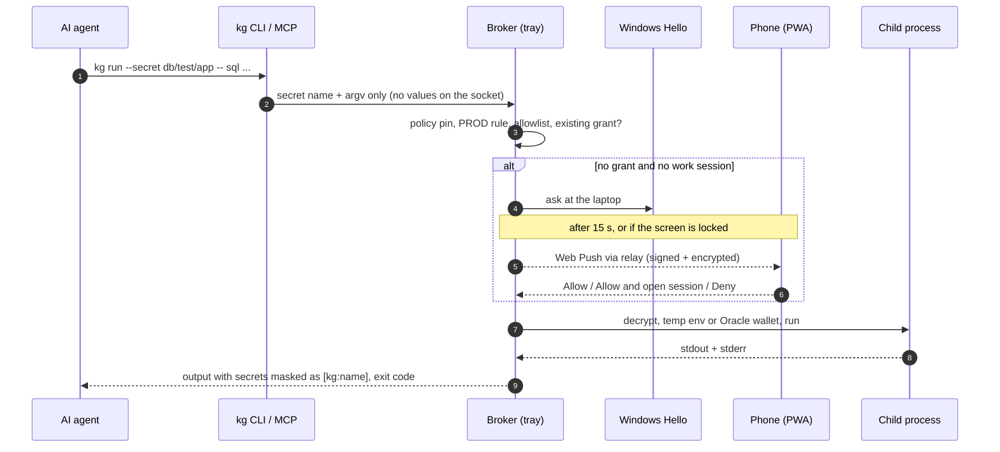

<div align="center">


# KeyGate

**A secret broker for AI coding agents.**<br>
Agents use passwords, API tokens and Oracle wallets without ever seeing them.

**English** · [Tiếng Việt](README.vi.md)

[](LICENSE)


[Why](#why) · [How it works](#how-it-works) · [Before and after](#before-and-after) · [Quick start](#quick-start) · [Security model](#security-model) · [Docs](#documentation)

</div>

---

## Why

> **228** passwords and tokens sat in 9 plain-text `.env` files on one developer laptop before they moved into KeyGate.

If an AI agent can read a file, it can read every password in it. Nobody means harm, but one slip is enough:

| Risk | What happens |
|---|---|
| **Leaks into answers** | The agent pastes a password into a chat, a report or a message it sends. |
| **Stays in logs** | A secret printed on screen ends up in a log file that travels everywhere. |
| **No trail** | Nobody knows which secret the agent used, against which system, at what time. |

## How it works

Think of a hotel front desk. The agent never holds the key. It asks the desk, the desk checks the book, you nod, and the desk opens the door for it.

| | Step | What happens |
|:-:|---|---|
| **1** | **The agent asks** | `kg run --secret db/test/app -- sql /@ebs_test @report.sql`: which secret, for which command. |
| **2** | **KeyGate checks the book** | Is this program, with these arguments, allowed for this secret in your pinned `policy.yaml`? Production secrets are denied by default. |
| **3** | **You approve** | One Windows Hello glance at the laptop, or tap **Allow** on your paired phone when you are away. Approve once and KeyGate remembers the pair. |
| **4** | **KeyGate opens the door** | The broker runs the command itself, injects the secret, and masks it in the output as `[kg:<name>]`. |

**The agent gets the result. The key never leaves the desk.**



### A day with KeyGate

| Time | |
|---|---|
| **07:45** | Log in, glance at the camera once. The vault opens and a work session starts; the tray icon turns green. |
| **09:00** | The agent runs queries, files tickets and syncs data all morning. Approved jobs run without asking again. |
| **14:00** | You end the session and go to a meeting. The agent needs a secret for the first time; your phone buzzes, you tap Allow or Deny. |
| **17:30** | Open the audit log: which secret, which command, which system, which exit code. Editing or deleting the log is detected. |

## Before and after

| | Before | With KeyGate |
|---|---|---|
| **Where passwords live** | Plain-text config files | An encrypted vault, opened only by your face or fingerprint |
| **Can the agent see them** | Yes, by reading the file | Never |
| **Who decides** | Nobody; readable means usable | You, with one tap |
| **Output printed by mistake** | The password in full | `[kg:name]` instead of the value |
| **Production systems** | Same as any other | Locked by default; opened only per secret, by name |
| **Knowing what the agent did** | No idea | A hash-chained audit log |
| **Lost laptop** | Lost secrets, rotate everything | Restore the vault on a new machine, revoke the old one |

## Features

- **`kg` CLI and broker** in Go (stdlib, `golang.org/x/crypto`, `golang.org/x/sys` only). On Windows the broker lives in the system tray (`kgw tray`).
- **Vault**: XChaCha20-Poly1305 records, one append-only log per device, Ed25519-signed membership events, recovery with master password + paper key.
- **Pinned policy**: per secret, the allowed programs and argument patterns, the approval kind (`user-presence`, `device`, `none` with hash-pinned scripts, `deny`), TTL and max runtime.
- **Secret delivery**: environment variable, temp file, temporary Oracle wallet (SQLcl), or a rendered template. Temp material is overwritten and removed.
- **Output masking**: verbatim, base64 and URL-encoded forms of every injected value.
- **Agent integration**: a PreToolUse hook that blocks reading `.env`, `cwallet*`, dumping the environment, `kg reveal`; an MCP server with `list_secrets`, `request_grant`, `run_with_secret`. No tool returns a value.
- **Phone approvals**: a PWA served by your own Cloudflare Worker, Web Push (tested on iOS), signed and encrypted envelopes, single-use decisions bound to the request hash.
- **Sync**: relay (Cloudflare Workers Free + Durable Object SQLite), git or a shared folder. The relay stores ciphertext and signed lines only.
- **Audit**: hash chain + per-line MAC, anchored head; truncation or deletion is detected.

## Quick start

```bash
# build
go build -o kg ./cmd/kg
go build -ldflags "-H=windowsgui" -o kgw.exe ./cmd/kg     # Windows tray broker
go test -count=1 -tags kgtest ./...

# create a vault (prints a paper key once: write it down)
kg init --label laptop

# start the broker: tray on Windows, foreground elsewhere
kgw tray        # or: kg broker

# add secrets, write a policy, apply it
kg set db/test/app --kind oracle-wallet --env test --tns-alias ebs_test --user APP
kg import --dotenv .env --prefix myrepo/ --env dev
kg policy apply

# let the agent use them
kg run --secret db/test/app -- sql /@ebs_test @D:/repos/x/sql/check.sql
```

A minimal `policy.yaml`:

```yaml
grants:
  db/test/*:
    kind: oracle-wallet
    tns_alias: ebs_test
    allow_commands: ["sql /@ebs_test @path:D:/repos/x/sql/**/*.sql"]
    approval: user-presence
    max_runtime: 10m
```

Relay and phone approvals: see [`relay/README.md`](relay/README.md) (`npx wrangler deploy`, put your vault ID in `ALLOWED_VAULTS`, generate VAPID keys with `node scripts/vapid.mjs`). Agent hooks and MCP: [`integrations/README.md`](integrations/README.md).

## Security model

- Secret values exist only in the broker's RAM and in the environment of the child process it starts. The CLI socket carries names and argv, never values, in either direction.
- The relay sees vault and device IDs, sizes and timestamps. It cannot read secret names or values, and tampering is detected by signatures, `prev` chains, high-water marks and checkpoints.
- **Known limits** (details in [`docs/DESIGN.md`](docs/DESIGN.md) and [`docs/CLI.md`](docs/CLI.md)): the masker does not catch hex, UTF-16, reversed or compressed forms, or values under 4 characters; there is a TOCTOU window between hashing a pinned script and running it; restoring an older `policy.yaml` + pin pair before the broker starts is not detected; the Cloudflare account that serves the PWA is part of the trust root for approvals.
- Not independently audited. Personal project, used daily on Windows 11 + iPhone. macOS Touch ID approval is untested on real hardware; Linux uses a device password and `device` approvals.

Found a security issue? Please open an issue without exploit details and ask for a private channel.

## Documentation

Docs are written in Vietnamese.

| | |
|---|---|
| [Landing page](https://ds-mrtq.github.io/keygate/docs/guide/gioi-thieu.html) | Plain-language introduction for non-technical readers |
| [User guide](https://ds-mrtq.github.io/keygate/docs/guide/index.html) | Setup, tray, policy, phone pairing, troubleshooting, with 5 interactive diagrams |
| [`docs/CLI.md`](docs/CLI.md) | Command reference |
| [`docs/DESIGN.md`](docs/DESIGN.md) | Cryptography, file formats, sync, relay protocol, broker rules |

## License

[MIT](LICENSE)
