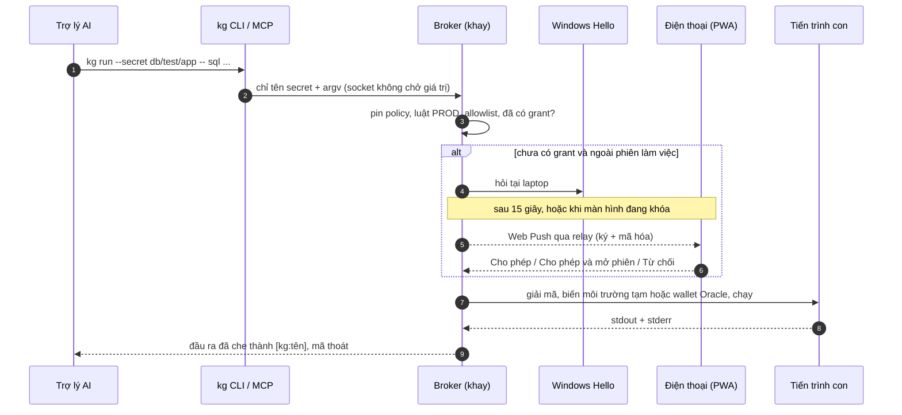

<div align="center">


# KeyGate

**Kho khóa cho AI agent.**<br>
Agent dùng được mật khẩu, API token, wallet Oracle mà không bao giờ nhìn thấy giá trị.

[English](README.md) · **Tiếng Việt**

[](LICENSE)




[Vì sao cần](#vì-sao-cần) · [Cách hoạt động](#cách-hoạt-động) · [Trước và sau](#trước-và-sau) · [Bắt đầu nhanh](#bắt-đầu-nhanh) · [Mô hình bảo mật](#mô-hình-bảo-mật) · [Tài liệu](#tài-liệu)

</div>

---

## Vì sao cần

> **228** mật khẩu và token từng nằm trong 9 file `.env` dạng chữ đọc được trên một laptop lập trình, trước khi chuyển vào KeyGate.

AI agent đọc được file nào thì thấy được mọi mật khẩu trong file đó. Giống như dán chìa khóa nhà lên cửa tủ lạnh rồi nhờ người khác vào dọn dẹp: không ai cố ý, nhưng chỉ cần một lần sơ suất.

| Rủi ro | Chuyện gì xảy ra |
|---|---|
| **Lọt vào câu trả lời** | Agent chép nguyên mật khẩu vào đoạn chat, báo cáo hay tin nhắn gửi đi. |
| **Nằm lại trong nhật ký** | Mật khẩu in ra màn hình rồi theo file log đi khắp nơi. |
| **Không ai biết đã dùng lúc nào** | Không có sổ ghi agent đã dùng mật khẩu nào, vào hệ thống nào, lúc nào. |

## Cách hoạt động

Như người giữ chìa khóa ở quầy lễ tân. Agent không được cầm chìa. Muốn vào đâu, agent phải hỏi quầy; quầy xem sổ, bạn gật đầu, quầy mở cửa giùm.

| | Bước | Chuyện gì xảy ra |
|:-:|---|---|
| **1** | **Agent xin vào** | `kg run --secret db/test/app -- sql /@ebs_test @report.sql`: cần secret nào, cho lệnh nào. |
| **2** | **KeyGate xem sổ** | Chương trình này, với các tham số này, có được phép dùng secret này trong `policy.yaml` đã ghim không? Secret PROD bị từ chối mặc định. |
| **3** | **Bạn gật đầu** | Một lần Windows Hello tại laptop, hoặc bấm **Cho phép** trên điện thoại đã ghép khi bạn không ngồi ở máy. Duyệt một lần, KeyGate nhớ cặp secret–lệnh đó. |
| **4** | **KeyGate mở cửa giùm** | Broker tự chạy lệnh, cấp secret cho tiến trình con và che giá trị trong đầu ra thành `[kg:<tên>]`. |

**Agent nhận kết quả. Chìa khóa không bao giờ rời quầy.**



### Một ngày với KeyGate

| Giờ | |
|---|---|
| **07:45** | Đăng nhập, nhìn camera một lần. Két mở, phiên làm việc bắt đầu; icon khay chuyển xanh lá. |
| **09:00** | Agent chạy truy vấn, tạo ticket, đồng bộ dữ liệu cả buổi sáng. Việc đã duyệt chạy ngay, không hỏi lại. |
| **14:00** | Bạn kết thúc phiên, đi họp. Agent cần một secret lần đầu; điện thoại rung, bạn bấm Cho phép hoặc Từ chối. |
| **17:30** | Mở sổ audit: secret nào, lệnh gì, hệ thống nào, mã thoát bao nhiêu. Sửa hay xóa sổ đều bị phát hiện. |

## Trước và sau

| | Trước | Với KeyGate |
|---|---|---|
| **Mật khẩu nằm ở đâu** | File cấu hình, chữ đọc được | Két mã hóa, chỉ mở bằng khuôn mặt hoặc vân tay của bạn |
| **Agent có thấy không** | Có, đọc file là thấy | Không bao giờ |
| **Ai quyết định cho dùng** | Không ai; đọc được là dùng | Bạn, bằng một chạm |
| **Lỡ in kết quả ra ngoài** | Lộ nguyên mật khẩu | Chỉ thấy `[kg:tên]` |
| **Hệ thống PROD** | Như mọi môi trường khác | Khóa sẵn; chỉ mở cho từng secret ghi đúng tên |
| **Biết agent đã làm gì** | Không biết | Sổ audit có chuỗi hash |
| **Mất laptop** | Mất mật khẩu, phải đổi hết | Khôi phục két sang máy mới, thu hồi máy cũ |

## Tính năng

- **CLI `kg` và broker** viết bằng Go (chỉ stdlib, `golang.org/x/crypto`, `golang.org/x/sys`). Trên Windows broker chạy ở khay hệ thống (`kgw tray`).
- **Vault**: bản ghi XChaCha20-Poly1305, mỗi thiết bị một log chỉ ghi thêm, sự kiện thành viên ký Ed25519, khôi phục bằng mật khẩu chủ + khóa giấy.
- **Policy ghim hash**: với từng secret, chương trình và mẫu tham số được phép, kiểu duyệt (`user-presence`, `device`, `none` khi script ghim hash, `deny`), TTL, thời gian chạy tối đa.
- **Cấp secret**: biến môi trường, file tạm, wallet Oracle tạm (SQLcl), hoặc file mẫu. Vật liệu tạm được ghi đè rồi xóa.
- **Che đầu ra**: dạng nguyên văn, base64 và URL-encode của mọi giá trị đã cấp.
- **Tích hợp agent**: hook PreToolUse chặn đọc `.env`, `cwallet*`, dump biến môi trường, `kg reveal`; MCP server với `list_secrets`, `request_grant`, `run_with_secret`. Không tool nào trả giá trị.
- **Duyệt bằng điện thoại**: PWA do chính Cloudflare Worker của bạn phục vụ, Web Push (đã chạy trên iOS), envelope ký và mã hóa, quyết định dùng một lần, gắn với bản băm của yêu cầu.
- **Đồng bộ**: relay (Cloudflare Workers Free + Durable Object SQLite), git hoặc thư mục chung. Relay chỉ lưu bản mã và dòng đã ký.
- **Audit**: chuỗi hash + MAC từng dòng, neo đầu chuỗi; cắt đuôi hay xóa đều bị phát hiện.

## Bắt đầu nhanh

Mười phút trên một máy Ubuntu 24.04 hoặc Windows 11 sạch (x86-64 hoặc arm64): cài bản phát hành,
kiểm tra SHA-256, tạo vault, và để một lệnh dùng một secret giả mà không nhìn thấy nó. Không cần
Go, không cần clone repo này, không cần tài khoản Cloudflare, không cần điện thoại.

Mọi lời nhắc bạn sẽ gặp và cần gõ gì được liệt kê ở
[các lời nhắc bạn sẽ thấy](#các-lời-nhắc-bạn-sẽ-thấy).

### 1. Cài trên Linux

Bằng script (tải bản phát hành mới nhất và `SHA256SUMS`, từ chối cài nếu checksum không khớp,
cài `kg` vào `~/.local/bin`, không cần `sudo`):

<!-- quickstart:linux-install-script -->
```bash
curl -fsSL https://raw.githubusercontent.com/ds-mrtq/keygate/main/install.sh | sh
export PATH="$HOME/.local/bin:$PATH"
kg version
```

Hoặc cài tay. Đặt `VERSION` là tag mới nhất trên [trang Releases](https://github.com/ds-mrtq/keygate/releases),
và `ARCH` là `arm64` trên máy ARM:

<!-- quickstart:linux-install-manual -->
```bash
VERSION=v0.1.0
ARCH=amd64
curl -fsSLO "https://github.com/ds-mrtq/keygate/releases/download/$VERSION/kg_${VERSION}_linux_$ARCH.tar.gz"
curl -fsSLO "https://github.com/ds-mrtq/keygate/releases/download/$VERSION/SHA256SUMS"
sha256sum -c --ignore-missing SHA256SUMS &&       # phải in: kg_..._linux_....tar.gz: OK
  mkdir -p ~/.local/bin &&
  tar -xzf "kg_${VERSION}_linux_$ARCH.tar.gz" -C ~/.local/bin kg
export PATH="$HOME/.local/bin:$PATH"
kg version                                        # phải in: kg <VERSION> (commit ..., linux/...)
```

Nếu `sha256sum` không in `OK`, tệp tải về không phải tệp đã phát hành và không có gì được cài. Thêm dòng
`export PATH=...` vào `~/.profile` để `kg` luôn có trong PATH.

### 2. Cài trên Windows

Trong PowerShell, bằng script (cài `kg.exe` và `kgw.exe` vào `%LOCALAPPDATA%\Programs\KeyGate`
và thêm thư mục đó vào PATH của người dùng, không cần quyền quản trị):

<!-- quickstart:windows-install-script -->
```powershell
irm https://raw.githubusercontent.com/ds-mrtq/keygate/main/install.ps1 | iex
kg version
```

Hoặc cài tay (`$Version` là tag mới nhất trên [trang Releases](https://github.com/ds-mrtq/keygate/releases);
dùng `arm64` thay cho `amd64` trên máy ARM):

<!-- quickstart:windows-install-manual -->
```powershell
$Version = 'v0.1.0'
$Zip = "kg_${Version}_windows_amd64.zip"
$Base = "https://github.com/ds-mrtq/keygate/releases/download/$Version"
Invoke-WebRequest "$Base/$Zip" -OutFile $Zip -UseBasicParsing
Invoke-WebRequest "$Base/SHA256SUMS" -OutFile SHA256SUMS -UseBasicParsing
$Want = ((Get-Content SHA256SUMS) -match " $Zip$" -split ' ')[0]
if ($Want -and (Get-FileHash $Zip -Algorithm SHA256).Hash.ToLower() -eq $Want) {
    $Dir = "$env:LOCALAPPDATA\Programs\KeyGate"
    Expand-Archive $Zip $Dir -Force
    [Environment]::SetEnvironmentVariable('Path', [Environment]::GetEnvironmentVariable('Path', 'User') + ";$Dir", 'User')
    $env:Path += ";$Dir"
    kg version                                    # phải in: kg <Version> (commit ..., windows/...)
} else {
    Write-Error "checksum mismatch: $Zip is not the published file"
}
```

Dừng lại nếu nó in `checksum mismatch`: chưa có gì được cài. Lần đầu chạy `kgw.exe`, Windows SmartScreen có thể cảnh báo
nhà phát hành không rõ vì tệp chưa được ký mã: chọn **More info**, rồi **Run anyway**.

Để kiểm tra cả nguồn gốc bản build, dùng [GitHub CLI](https://cli.github.com/):
`gh attestation verify <tệp nén> --repo ds-mrtq/keygate`. Xem thêm [`docs/RELEASE.md`](docs/RELEASE.md) (tiếng Anh).

### 3. Chạy lần đầu trên Linux

Bạn cần hai terminal. **Terminal 1** là terminal riêng của broker: nó giữ vault mở và là nơi duy
nhất gõ giá trị và duyệt. **Terminal 2** là nơi bạn, hoặc sau này một AI agent, chạy lệnh.

Ở terminal 1, tạo vault, rồi chạy broker và để nó chạy:

<!-- quickstart:linux-terminal-1 -->
```bash
kg init --label laptop
kg broker
```

`kg init` hỏi một mật khẩu chủ mới và một mật khẩu mở khóa thiết bị mới, rồi in **khóa giấy** một
lần: chép lại và cất ngoài máy này. `kg broker` hỏi mật khẩu mở khóa thiết bị và in
`[broker] đã mở khóa`.

Ở terminal 2, lưu một secret giả, viết một script demo nhỏ, ghim nó trong policy, áp dụng policy
và chạy script với secret:

<!-- quickstart:linux-terminal-2 -->
```bash
kg set demo/token --kind env --env-name DEMO_TOKEN --env test
mkdir -p ~/kg-demo
printf '#!/bin/sh\necho "deploying with token $DEMO_TOKEN"\n' > ~/kg-demo/demo.sh
cat > ~/.keygate/policy.yaml <<EOF
grants:
  demo/token:
    kind: env
    allow_commands: ['sh "path:$HOME/kg-demo/demo.sh" $(kg hash ~/kg-demo/demo.sh) !exact']
    approval: user-presence
EOF
kg policy apply
kg run --secret demo/token -- sh ~/kg-demo/demo.sh
kg audit show
```

Điều gì xảy ra:

1. `kg set` hỏi giá trị **ở terminal 1**. Gõ một giá trị giả bất kỳ, ví dụ `fake-token-123`.
   Giá trị không bao giờ đi qua terminal 2 hay socket.
2. `kg policy apply` hiện policy ở terminal 1 và hỏi mật khẩu mở khóa thiết bị ở đó để duyệt.
3. `kg run` không cần duyệt thêm: broker đã mở một phiên làm việc khi mở khóa. Terminal 2 in
   `deploying with token [kg:demo/token]`: script nhận được giá trị, đầu ra thì không.
4. `kg audit show` hỏi mật khẩu mở khóa thiết bị ở terminal 2 (nó tự mở nhật ký audit) và liệt kê
   mọi thao tác. Dòng `policy` kết thúc bằng `approval=tty-password` (duyệt ở terminal 1); dòng
   cuối là lần chạy, không có giá trị:
   `... run       demo/token env=test agent=cli ... approval=session exit=0 | ["sh" "/home/you/kg-demo/demo.sh"]`.

**Quy tắc duyệt trên Linux.** Linux không có Windows Hello hay Touch ID, nên duyệt là gõ mật khẩu
mở khóa thiết bị tại một terminal tương tác gắn với chính broker (stdin là TTY, hoặc `/dev/tty`).
Mật khẩu đưa vào qua pipe, hoặc gửi qua socket, biến môi trường, cờ hay bất kỳ lệnh client nào, đều
bị từ chối, và broker chuyển sang duyệt từ thiết bị khác. Vì vậy việc duyệt diễn ra ở terminal 1,
không bao giờ ở terminal 2, nơi agent chạy.

### 4. Chạy lần đầu trên Windows

Trong PowerShell:

<!-- quickstart:windows-init -->
```powershell
kg init --label laptop
```

Lệnh hỏi mật khẩu chủ mới hai lần, rồi in **khóa giấy** một lần: chép lại và cất ngoài máy này.
Trên Windows, khóa thiết bị được bảo vệ bằng tài khoản Windows của bạn, nên không có mật khẩu
thiết bị.

Chạy broker khay: chạy `kgw tray`, hoặc nhấp đúp `kgw.exe`. Windows Hello hỏi khuôn mặt, vân tay
hoặc PIN, và biểu tượng khay chuyển xanh. Sau đó:

```powershell
kg set demo/token --kind env --env-name DEMO_TOKEN --env test
New-Item -ItemType Directory -Force "$HOME\kg-demo" | Out-Null
Set-Content "$HOME\kg-demo\demo.ps1" 'Write-Output "deploying with token $env:DEMO_TOKEN"'
$Script = "$HOME\kg-demo\demo.ps1" -replace '\\', '/'
$Hash = kg hash "$HOME\kg-demo\demo.ps1"
Set-Content "$HOME\.keygate\policy.yaml" -Encoding UTF8 @"
grants:
  demo/token:
    kind: env
    allow_commands: ['powershell "path:$Script" $Hash !exact']
    approval: user-presence
"@
kg policy apply
kg run --secret demo/token -- powershell "$HOME\kg-demo\demo.ps1"
kg audit show
```

`kg set` mở hộp thoại KeyGate để nhập giá trị: gõ một giá trị giả. `kg policy apply` hiện policy và
hỏi Windows Hello. `kg run` in `deploying with token [kg:demo/token]`, và `kg audit show` liệt kê
lần chạy. Nếu Windows Hello chưa được thiết lập, thông báo lỗi chỉ chỗ bật nó:
Settings > Accounts > Sign-in options.

### Các lời nhắc bạn sẽ thấy

| Lời nhắc | Ở đâu | Gõ gì |
|---|---|---|
| `Mật khẩu chủ (>= 12 ký tự):` | `kg init` | Một mật khẩu mới; cùng với khóa giấy, nó cần cho các thao tác của chủ sở hữu |
| `Nhập lại mật khẩu chủ:` | `kg init` | Gõ lại như trên |
| `Mật khẩu mở khóa thiết bị:` | `kg init`, `kg broker`, `kg audit show` (Linux) | Mật khẩu mới ở `kg init`, sau đó gõ đúng mật khẩu ấy |
| `Nhập lại:` | `kg init` (Linux) | Gõ lại như trên |
| `KHÓA GIẤY` | `kg init` | Không gõ gì: chép lại |
| `[broker] Nhập giá trị cho "demo/token"` | Terminal 1 | Giá trị giả (ẩn) |
| `Mật khẩu mở khóa thiết bị để duyệt:` | Terminal 1 | Mật khẩu mở khóa thiết bị, sau khi đọc phần xem lại phía trên |

Mọi thứ gõ ở lời nhắc mật khẩu đều không hiện ra.

### Bước tiếp theo

- **Secret của bạn**: `kg import --dotenv .env --prefix myrepo/ --env dev`, rồi một grant cho mỗi
  secret trong `policy.yaml` và `kg policy apply`. Tham khảo: [`docs/CLI.md`](docs/CLI.md) (tiếng Anh).
- **Hook và MCP cho agent**: [`integrations/README.md`](integrations/README.md).
- **Duyệt bằng điện thoại** qua Cloudflare Worker của riêng bạn: [`relay/README.md`](relay/README.md).

### Oracle wallet

Secret loại `oracle-wallet` được giao cho SQLcl dưới dạng wallet tạm. Nó cần grant riêng, thêm vào
`policy.yaml` cạnh `demo/token` và áp dụng bằng `kg policy apply` trước `kg run`:

```yaml
grants:
  db/test/*:
    kind: oracle-wallet
    tns_alias: ebs_test
    allow_commands: ["sql /@ebs_test @path:D:/repos/x/sql/**/*.sql"]
    approval: user-presence
    max_runtime: 10m
```

```bash
kg set db/test/app --kind oracle-wallet --env test --tns-alias ebs_test --user APP
kg run --secret db/test/app -- sql /@ebs_test @D:/repos/x/sql/check.sql
```

### Build từ mã nguồn

Cần Go (phiên bản trong [`go.mod`](go.mod)).

```bash
go build -o kg ./cmd/kg
go build -ldflags "-H=windowsgui" -o kgw.exe ./cmd/kg     # broker khay trên Windows
go test -count=1 -tags kgtest ./...
```

## Mô hình bảo mật

- Giá trị secret chỉ nằm trong RAM của broker và trong môi trường của tiến trình con do broker chạy. Socket giữa CLI và broker chỉ chở tên và argv, không chở giá trị theo cả hai chiều.
- Relay thấy ID vault, ID thiết bị, kích thước, thời điểm. Relay không đọc được tên hay giá trị secret; sửa dữ liệu trên relay bị phát hiện qua chữ ký, chuỗi `prev`, high-water mark và checkpoint.
- **Giới hạn đã biết** (chi tiết ở [`docs/DESIGN.md`](docs/DESIGN.md) và [`docs/CLI.md`](docs/CLI.md)): `kg delete` chỉ ẩn secret vì log thiết bị chỉ ghi thêm: thiết bị đã ghép và khóa giấy khôi phục vẫn đọc được giá trị cũ, nên đổi mật khẩu/token thật nếu có thể đã lộ; bộ che không bắt dạng hex, UTF-16, chuỗi đảo, nén, hay giá trị dưới 4 ký tự; còn khe TOCTOU giữa lúc băm script đã ghim và lúc chạy; khôi phục cặp `policy.yaml` + pin cũ trước khi broker khởi động không bị phát hiện; tài khoản Cloudflare phục vụ PWA là một phần gốc tin cậy cho quyền duyệt.
- Chưa có kiểm toán bảo mật độc lập. Dự án cá nhân, dùng hằng ngày trên Windows 11 + iPhone. Duyệt Touch ID trên macOS chưa kiểm trên máy thật; trên Linux, duyệt dùng mật khẩu mở khóa thiết bị, chỉ được nhận khi gõ tại terminal tương tác gắn với chính broker (stdin là TTY, hoặc `/dev/tty`). Mật khẩu đến qua pipe, socket, biến môi trường, cờ hay lệnh client đều bị từ chối, và broker chuyển sang duyệt từ thiết bị khác (`approval: device` không đổi).

Phát hiện lỗi bảo mật: mở issue không kèm chi tiết khai thác và đề nghị một kênh riêng.

## Tài liệu

| | |
|---|---|
| [Trang giới thiệu](https://ds-mrtq.github.io/keygate/docs/guide/gioi-thieu.html) | Giới thiệu dễ hiểu cho người không chuyên |
| [Hướng dẫn sử dụng](https://ds-mrtq.github.io/keygate/docs/guide/index.html) | Cài đặt, khay, policy, ghép điện thoại, xử lý sự cố, kèm 5 sơ đồ tương tác |
| [`docs/CLI.md`](docs/CLI.md) | Tham chiếu lệnh |
| [`docs/DESIGN.md`](docs/DESIGN.md) | Mật mã, định dạng file, đồng bộ, giao thức relay, luật broker |

## Giấy phép

[MIT](LICENSE)
