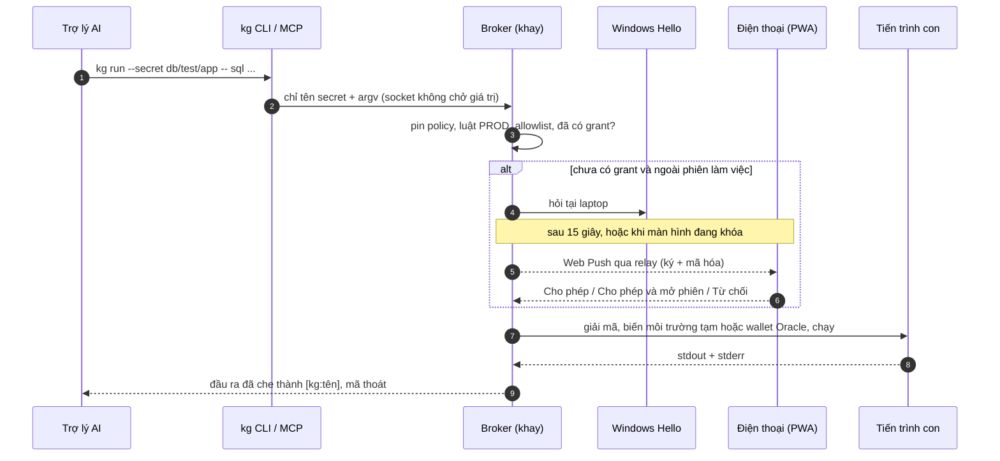

<div align="center">


# KeyGate

**Kho khóa cho AI agent.**<br>
Agent dùng được mật khẩu, API token, wallet Oracle mà không bao giờ nhìn thấy giá trị.

[English](README.md) · **Tiếng Việt**

[](LICENSE)


[Vì sao cần](#vì-sao-cần) · [Cách hoạt động](#cách-hoạt-động) · [Trước và sau](#trước-và-sau) · [Bắt đầu nhanh](#bắt-đầu-nhanh) · [Mô hình bảo mật](#mô-hình-bảo-mật) · [Tài liệu](#tài-liệu)

</div>

---

## Vì sao cần

> **228** mật khẩu và token từng nằm trong 9 file `.env` dạng chữ đọc được trên một laptop lập trình, trước khi chuyển vào KeyGate.

AI agent đọc được file nào thì thấy được mọi mật khẩu trong file đó. Giống như dán chìa khóa nhà lên cửa tủ lạnh rồi nhờ người khác vào dọn dẹp: không ai cố ý, nhưng chỉ cần một lần sơ suất.

| Rủi ro | Chuyện gì xảy ra |
|---|---|
| **Lọt vào câu trả lời** | Agent chép nguyên mật khẩu vào đoạn chat, báo cáo hay tin nhắn gửi đi. |
| **Nằm lại trong nhật ký** | Mật khẩu in ra màn hình rồi theo file log đi khắp nơi. |
| **Không ai biết đã dùng lúc nào** | Không có sổ ghi agent đã dùng mật khẩu nào, vào hệ thống nào, lúc nào. |

## Cách hoạt động

Như người giữ chìa khóa ở quầy lễ tân. Agent không được cầm chìa. Muốn vào đâu, agent phải hỏi quầy; quầy xem sổ, bạn gật đầu, quầy mở cửa giùm.

| | Bước | Chuyện gì xảy ra |
|:-:|---|---|
| **1** | **Agent xin vào** | `kg run --secret db/test/app -- sql /@ebs_test @report.sql`: cần secret nào, cho lệnh nào. |
| **2** | **KeyGate xem sổ** | Chương trình này, với các tham số này, có được phép dùng secret này trong `policy.yaml` đã ghim không? Secret PROD bị từ chối mặc định. |
| **3** | **Bạn gật đầu** | Một lần Windows Hello tại laptop, hoặc bấm **Cho phép** trên điện thoại đã ghép khi bạn không ngồi ở máy. Duyệt một lần, KeyGate nhớ cặp secret–lệnh đó. |
| **4** | **KeyGate mở cửa giùm** | Broker tự chạy lệnh, cấp secret cho tiến trình con và che giá trị trong đầu ra thành `[kg:<tên>]`. |

**Agent nhận kết quả. Chìa khóa không bao giờ rời quầy.**



### Một ngày với KeyGate

| Giờ | |
|---|---|
| **07:45** | Đăng nhập, nhìn camera một lần. Két mở, phiên làm việc bắt đầu; icon khay chuyển xanh lá. |
| **09:00** | Agent chạy truy vấn, tạo ticket, đồng bộ dữ liệu cả buổi sáng. Việc đã duyệt chạy ngay, không hỏi lại. |
| **14:00** | Bạn kết thúc phiên, đi họp. Agent cần một secret lần đầu; điện thoại rung, bạn bấm Cho phép hoặc Từ chối. |
| **17:30** | Mở sổ audit: secret nào, lệnh gì, hệ thống nào, mã thoát bao nhiêu. Sửa hay xóa sổ đều bị phát hiện. |

## Trước và sau

| | Trước | Với KeyGate |
|---|---|---|
| **Mật khẩu nằm ở đâu** | File cấu hình, chữ đọc được | Két mã hóa, chỉ mở bằng khuôn mặt hoặc vân tay của bạn |
| **Agent có thấy không** | Có, đọc file là thấy | Không bao giờ |
| **Ai quyết định cho dùng** | Không ai; đọc được là dùng | Bạn, bằng một chạm |
| **Lỡ in kết quả ra ngoài** | Lộ nguyên mật khẩu | Chỉ thấy `[kg:tên]` |
| **Hệ thống PROD** | Như mọi môi trường khác | Khóa sẵn; chỉ mở cho từng secret ghi đúng tên |
| **Biết agent đã làm gì** | Không biết | Sổ audit có chuỗi hash |
| **Mất laptop** | Mất mật khẩu, phải đổi hết | Khôi phục két sang máy mới, thu hồi máy cũ |

## Tính năng

- **CLI `kg` và broker** viết bằng Go (chỉ stdlib, `golang.org/x/crypto`, `golang.org/x/sys`). Trên Windows broker chạy ở khay hệ thống (`kgw tray`).
- **Vault**: bản ghi XChaCha20-Poly1305, mỗi thiết bị một log chỉ ghi thêm, sự kiện thành viên ký Ed25519, khôi phục bằng mật khẩu chủ + khóa giấy.
- **Policy ghim hash**: với từng secret, chương trình và mẫu tham số được phép, kiểu duyệt (`user-presence`, `device`, `none` khi script ghim hash, `deny`), TTL, thời gian chạy tối đa.
- **Cấp secret**: biến môi trường, file tạm, wallet Oracle tạm (SQLcl), hoặc file mẫu. Vật liệu tạm được ghi đè rồi xóa.
- **Che đầu ra**: dạng nguyên văn, base64 và URL-encode của mọi giá trị đã cấp.
- **Tích hợp agent**: hook PreToolUse chặn đọc `.env`, `cwallet*`, dump biến môi trường, `kg reveal`; MCP server với `list_secrets`, `request_grant`, `run_with_secret`. Không tool nào trả giá trị.
- **Duyệt bằng điện thoại**: PWA do chính Cloudflare Worker của bạn phục vụ, Web Push (đã chạy trên iOS), envelope ký và mã hóa, quyết định dùng một lần, gắn với bản băm của yêu cầu.
- **Đồng bộ**: relay (Cloudflare Workers Free + Durable Object SQLite), git hoặc thư mục chung. Relay chỉ lưu bản mã và dòng đã ký.
- **Audit**: chuỗi hash + MAC từng dòng, neo đầu chuỗi; cắt đuôi hay xóa đều bị phát hiện.

## Bắt đầu nhanh

Tải bản phát hành, xác minh và ký: [Releases](docs/RELEASE.md) (tiếng Anh).

```bash
# build
go build -o kg ./cmd/kg
go build -ldflags "-H=windowsgui" -o kgw.exe ./cmd/kg     # broker khay trên Windows
go test -count=1 -tags kgtest ./...

# tạo vault (khóa giấy in một lần: chép lại cẩn thận)
kg init --label laptop

# chạy broker: khay trên Windows, foreground ở nơi khác
kgw tray        # hoặc: kg broker

# thêm secret, viết policy, áp dụng
kg set db/test/app --kind oracle-wallet --env test --tns-alias ebs_test --user APP
kg import --dotenv .env --prefix myrepo/ --env dev
kg policy apply

# cho agent dùng
kg run --secret db/test/app -- sql /@ebs_test @D:/repos/x/sql/check.sql
```

`policy.yaml` tối thiểu:

```yaml
grants:
  db/test/*:
    kind: oracle-wallet
    tns_alias: ebs_test
    allow_commands: ["sql /@ebs_test @path:D:/repos/x/sql/**/*.sql"]
    approval: user-presence
    max_runtime: 10m
```

Relay và duyệt bằng điện thoại: xem [`relay/README.md`](relay/README.md) (`npx wrangler deploy`, điền ID vault vào `ALLOWED_VAULTS`, sinh khóa VAPID bằng `node scripts/vapid.mjs`). Hook và MCP cho agent: [`integrations/README.md`](integrations/README.md).

## Mô hình bảo mật

- Giá trị secret chỉ nằm trong RAM của broker và trong môi trường của tiến trình con do broker chạy. Socket giữa CLI và broker chỉ chở tên và argv, không chở giá trị theo cả hai chiều.
- Relay thấy ID vault, ID thiết bị, kích thước, thời điểm. Relay không đọc được tên hay giá trị secret; sửa dữ liệu trên relay bị phát hiện qua chữ ký, chuỗi `prev`, high-water mark và checkpoint.
- **Giới hạn đã biết** (chi tiết ở [`docs/DESIGN.md`](docs/DESIGN.md) và [`docs/CLI.md`](docs/CLI.md)): `kg delete` chỉ ẩn secret vì log thiết bị chỉ ghi thêm: thiết bị đã ghép và khóa giấy khôi phục vẫn đọc được giá trị cũ, nên đổi mật khẩu/token thật nếu có thể đã lộ; bộ che không bắt dạng hex, UTF-16, chuỗi đảo, nén, hay giá trị dưới 4 ký tự; còn khe TOCTOU giữa lúc băm script đã ghim và lúc chạy; khôi phục cặp `policy.yaml` + pin cũ trước khi broker khởi động không bị phát hiện; tài khoản Cloudflare phục vụ PWA là một phần gốc tin cậy cho quyền duyệt.
- Chưa có kiểm toán bảo mật độc lập. Dự án cá nhân, dùng hằng ngày trên Windows 11 + iPhone. Duyệt Touch ID trên macOS chưa kiểm trên máy thật; Linux dùng mật khẩu thiết bị và duyệt `device`.

Phát hiện lỗi bảo mật: mở issue không kèm chi tiết khai thác và đề nghị một kênh riêng.

## Tài liệu

| | |
|---|---|
| [Trang giới thiệu](https://ds-mrtq.github.io/keygate/docs/guide/gioi-thieu.html) | Giới thiệu dễ hiểu cho người không chuyên |
| [Hướng dẫn sử dụng](https://ds-mrtq.github.io/keygate/docs/guide/index.html) | Cài đặt, khay, policy, ghép điện thoại, xử lý sự cố, kèm 5 sơ đồ tương tác |
| [`docs/CLI.md`](docs/CLI.md) | Tham chiếu lệnh |
| [`docs/DESIGN.md`](docs/DESIGN.md) | Mật mã, định dạng file, đồng bộ, giao thức relay, luật broker |

## Giấy phép

[MIT](LICENSE)
